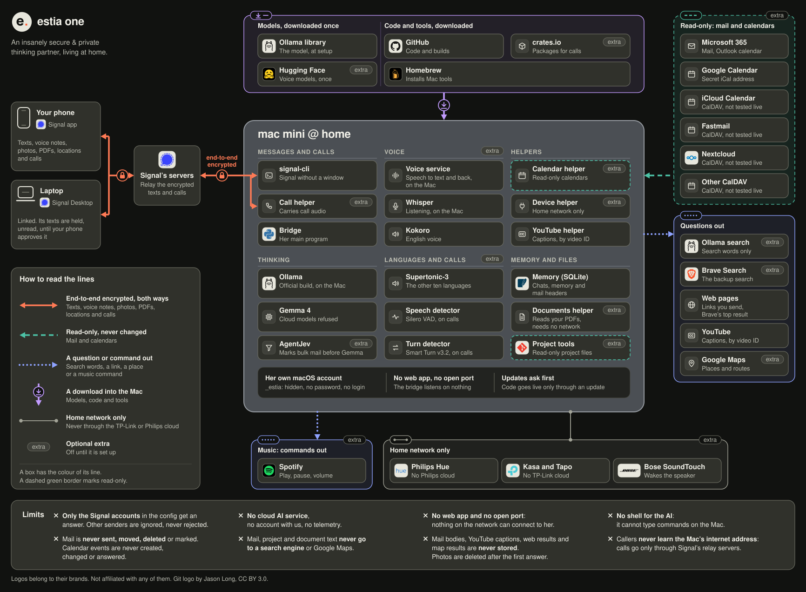

# Estia

<picture>
  <source media="(prefers-color-scheme: dark)" srcset="docs/brand/estia-hero-dark.png">
  
</picture>

**An insanely secure & private thinking partner, living at home.** Estia (Εστία, the hearth) runs on one Mac at home and is reached only through Signal: encrypted texts, voice notes and calls. Name her what you like. Ours is called Tiffany. Estia started as Tiffany, our own thinking partner, before she was opened up for every home. Her Signal picture is her name's first letter with Estia's orange full stop, accents left out (Ángela gets an a.); a first letter outside a to z even then, such as Greek or Chinese, keeps Estia's e.

Website: [estia.one](https://estia.one)

## Security

Insanely secure, and every claim can be checked in the open-source code.

- **Local.** Gemma, Google's open AI model, runs on the Mac through Ollama's official build; a cloud model, which Ollama runs on its own servers, is refused. No cloud AI service, no account with us, no telemetry. Chats, memory and profile stay on the Mac.
- **Read-only mail and calendars.** She never sends, moves, deletes or marks mail, and never changes a calendar event.
- **Lights and plugs follow a rule set per device.** Each device is `normal`, `ask first` or `never off` (switching it off is refused). A device change after outside text waits for your yes.
- **Only Signal.** Reached through Signal on your phone or Signal Desktop on your laptop. No web app and no open port: the bridge listens on nothing, so nothing on the network can connect to her. Messages travel end-to-end encrypted through Signal. Only the Signal accounts in the config get an answer.
- **Keys stay put.** Keys and sign-ins never appear in chat, logs or the code repository. Only her own hidden macOS account, `_estia`, can read the keys: a program you run needs your Mac password to read them, as long as no admin rule skips that password (the security step checks).

All of it in plain words: [Safe and private](GUIDE.md#safe-and-private-in-plain-words). Known gaps: [SECURITY.md](SECURITY.md#known-accepted-gaps).

## Architecture

<p align="center">
  <a href="docs/images/estia-architecture-dark.svg"></a>
</p>

Estia runs on one Mac mini at home and is reached only through Signal: texts, voice notes, photos, PDFs, locations and calls, end-to-end encrypted. No web app, no open port. She reads mail and calendars but never changes them. Searches, web pages, YouTube captions and Google Maps are questions out; mail, project and document text never go to a search engine or Google Maps. Models, code and tools are downloaded into the Mac. Lights, plugs and speakers are reached over the home network only, never through the TP-Link or Philips cloud. Click the diagram for the full-size version.

## What she does

One line and one example each. Every detail and limit: [What she can do](GUIDE.md#what-she-can-do).

 Works once setup is done.

- **Chat.** A short, direct answer. The conversation is remembered, her own notes too: reminders set, the digest, calendar changes. Example: "What's a good question to ask about free will?"

- **Memory.** Saves what you tell her, known in every message, and notes from your chats, given when they matter. Facts can be listed, corrected or removed. Example: "Remember that …", then `/profile`, `/fix` or `/forget`.

- **Reminders.** A text at that time: once, every day, every weekday or every week. A reminder is set only when a note from the code, not from the AI, says so. Example: "Remind me at 17:00 to call the dentist".

- **Language practice.** A short conversation in Dutch (or one of seven other languages) at level A2 or B1, then a recap of at most three mistakes as a text. Example: `/babble nl`.

- **Saved lists.** Ideas from a list you saved (songs, books, recipes). Example: "What should we play next?"

- **The Mac.** A few lines on its health. Real problems are reported without being asked. Example: "How is the Mac doing?"

- **Photos.** An answer about the photo. The photo is deleted after the first answer. Example: a photo with a question.

- **YouTube videos.** A summary from the video's captions, with the time of each main point. The captions are never stored. Example: a YouTube link, with or without a question.

- **Emergency stop.** `/lock` stops everything at once (answers, messages she starts, calls and reminders) until `/unlock` from the same device, 10 minutes later at the earliest. Example: `/lock`.

 Off until you turn it on.

- **Messages she starts.** Now and then: a check-in, a calendar change or an early start, a Sunday look back, a spontaneous note. At most one a day, never between 22:00 and 08:00. Example: `/initiative on` (off until you do).

- **Evening note.** Three short questions at 21:00, or the time you pick: what went well, what is still open, one thing for tomorrow. The same words each evening, written by the code, never by the AI. Example: `/evening on` (off until you do).

 Each one stays off until it is set up: `scripts/setup.sh --extras` lists them.

- **Calls.** A spoken conversation that can be interrupted. A short summary text follows a call of two or more turns. Example: call her on Signal.

- **Wake-up calls.** A text, then a Signal call at that time (once calls are set up). Example: "Call me at 7:00 to wake me up".

- **Voice notes.** Transcribed on the Mac, answered in text, and optionally read back as a voice note (`/voice`). Example: a voice note, in her language.

- **Calendar.** That day's events from each calendar, with times and places. Example: "What's on Friday?"

- **Mail.** Unanswered mail from the last week, numbered. "Read 2" opens one. Microsoft 365 mailboxes; Gmail is not built in. Example: "What needs my reply?"

- **Morning digest.** Today's calendar, tomorrow in one line, then the mail that needs a reply. Example: none needed; it comes at 09:15 on its own.

- **Music.** Spotify on your speakers (once set up). Music is text only. Example: "Play some jazz".

- **Lights and plugs.** Kasa devices and Philips Hue lights on the home network, never through the TP-Link or Philips cloud. Only Kasa devices are tested. Example: "Turn off the living room lamp".

- **Web search.** An answer that names the site and how recent it is, plus a Sources message. Example: "Who won the match last night?"

- **Chords.** Chords, key and tempo from a chord site, with a Sources message. Example: "What are the chords of Spooky?"

- **Places and routes.** Up to five places with rating, price and today's hours, or the time, distance and lines, with Google Maps links (once set up). Example: "How long to the station by bike?"

- **Projects.** Open to-do items and recent changes from a project on the Mac. An extra, off by default. Example: "What's next on \<project>?"

- **Documents.** An answer from your PDFs that names the document and the page. An extra, off by default. Example: "What does my lease say about pets?"

- **Transposing chords.** Chords transposed or moved for a capo, a chord's notes and the key of given chords, worked out on the Mac and given in a note from the code, not from the AI. An extra, off by default. Example: "Get the chords of Spooky and transpose them 4 semitones higher".

## Install

**1. A Mac and a number.** A Mac with Apple silicon and 16 GB of memory or more, plus a spare phone number for her Signal account. On 16 or 24 GB the smaller model failed some of her safety tests (SECURITY.md, known gaps). 32 GB with Gemma 26B is the tested setup.

**2. Two lines, in your own Terminal window.** Setup asks its questions there, and the Signal codes, passwords and keys are typed hidden. Over a remote login (SSH), run it inside `screen` (built into macOS), so a dropped connection does not stop it.

```sh
git clone https://github.com/enable4all/estia-one-mmini.git ~/estia && cd ~/estia
scripts/setup.sh
```

**3. Check.** Setup is done when `/usr/bin/sudo /usr/local/estia/bin/estia doctor` shows no ✗ and her welcome message has arrived on your phone: reply to it to see her answer.

**How long:** downloads and builds take about 30 minutes on a 100 Mbit/s line, most of it the model download (18.3 GB); about 15 minutes on a Mac with 16 or 24 GB of memory, where the model is 7.7 GB. Voice adds about 15 minutes while her voice loads, after its build and a 1.7 GB download (about 4 minutes). Each step, measured or computed: [How long it takes](GUIDE.md#how-long-it-takes).

A Mac without Apple's Command Line Tools, which hold git, asks to install them in a window on its own screen. Over a remote login (SSH), run Homebrew's installer first, which installs them (your Mac password once): `/bin/bash -c "$(curl -fsSL https://raw.githubusercontent.com/Homebrew/install/HEAD/install.sh)"`, then the two lines above.

Or open the folder in an AI coding assistant (Claude Code, Codex, ...) and say **"set me up"**. It follows [SETUP-WITH-YOUR-AI.md](SETUP-WITH-YOUR-AI.md): it checks the Mac and explains each question before it comes, and you run `scripts/setup.sh` in your own Terminal window, where the Signal codes, passwords and keys are typed hidden. `/usr/bin/sudo /usr/local/estia/bin/estia doctor` checks the result.

## Everything else

[GUIDE.md](GUIDE.md) has the rest: [what she can do](GUIDE.md#what-she-can-do) · [languages](GUIDE.md#languages) · [language practice](GUIDE.md#language-practice) · [safe and private](GUIDE.md#safe-and-private-in-plain-words) · [what runs where](GUIDE.md#what-runs-where) · [when something is off](GUIDE.md#when-something-is-off) · [slash commands](GUIDE.md#slash-commands) · [requirements](GUIDE.md#requirements) · [a rented Mac (VPS)](GUIDE.md#a-rented-mac-vps) · [set it up](GUIDE.md#set-it-up) · [what's next](GUIDE.md#whats-next) · [for developers](GUIDE.md#for-developers). Every sign-in and key, step by step: [setup_assistant.md](setup_assistant.md).

Not affiliated with Signal, Spotify, Google, Microsoft, Apple, Amazon, Bose, TP-Link, Philips, Fastmail, Nextcloud, Scaleway, MacStadium, Ollama, OpenAI, Anthropic, Hugging Face, Brave, GitHub, Homebrew, crates.io or OpenClaw.

## License

This project is MIT licensed (see [LICENSE](LICENSE)). The call helper in `tools/call-tunnel/` is AGPL-3.0-only, because the patch it contains modifies AGPL-3.0 code; see [its notice](tools/call-tunnel/LICENSE-NOTICE.md). Other third-party components and their licences are listed in [THIRD_PARTY_NOTICES.md](THIRD_PARTY_NOTICES.md).
